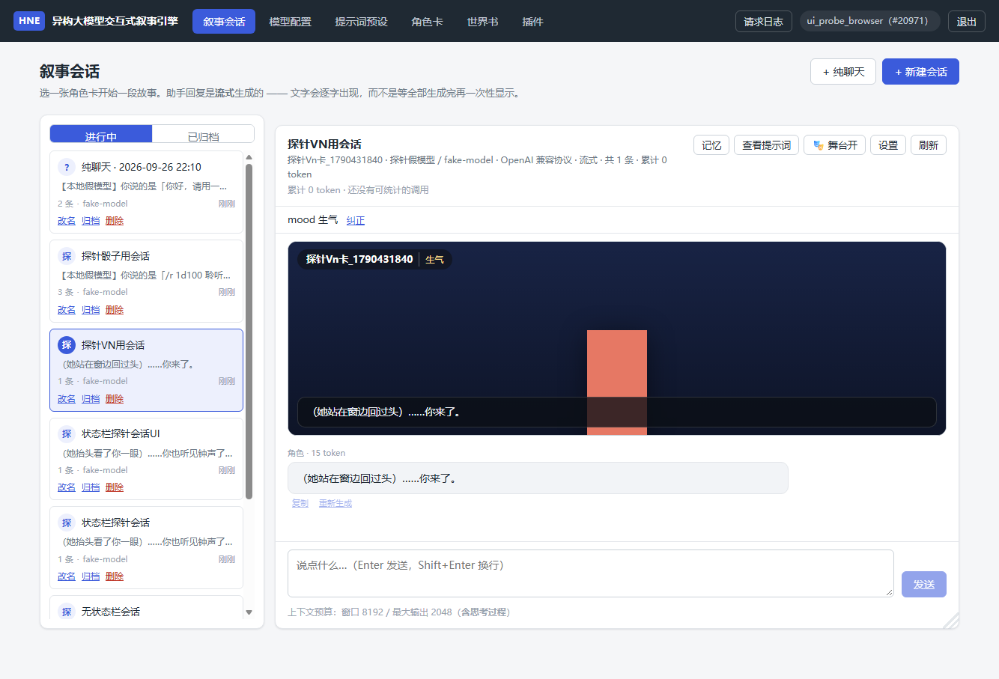
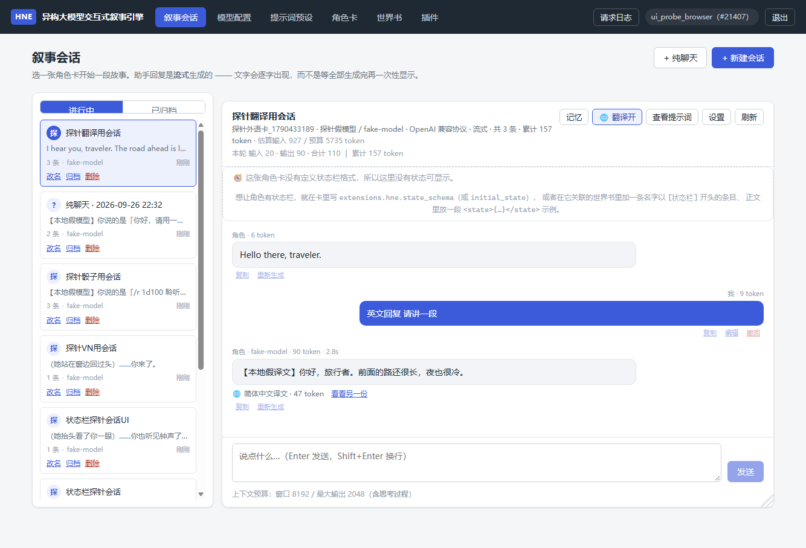

# 扩展功能：骰子 / VN 立绘 / 翻译 / 对话分支

> 云梦枢文档之一 · 返回 [README 索引](../README.md)

### 🎲 骰子插件：随机数由**后端**掷，模型只负责叙述

大模型**没有真随机**：同一个提示词下它倾向于给出"恰到好处"的数字
（需要成功就写 18、需要失败就写 3），同一个骰点两次回答还能不一样。
跑团 / 检定 / 掉落表的乐趣恰恰建立在"结果不由叙述者决定"上，
所以骰点由后端的**受控求值器**掷出，模型只解释结果。

```
玩家：/r 1d20+5 力量检定        → 🎲 力量检定 1d20+5 = 17 （骰子 12）
模型：他抬手格挡。<roll>1d20+5</roll>
      → 系统替换成 （掷骰 1d20+5 = 17）（骰子 12），下一轮模型看到的就是这个数
```

| 记法 | 含义 |
|---|---|
| `1d100` / `d20` | 一个百分骰 / 省略个数 = 1 |
| `2d6+3` | 两枚六面骰加 3（支持 `+ - * / // %` 与括号） |
| `4d6kh3` / `4d6kl1` | 四取最高的三枚 / 取最低的一枚（属性生成常用） |
| `2d6!` | 爆炸骰（掷出最大面再掷一颗，**有深度上限**） |
| `1d20+5<=15` | 带成功判定（结果里直接写"成功/失败"） |
| `1d100 # 聆听` 或 `1d100 聆听` | `#` 之后（或表达式之后）是这次掷骰的用途 |

三条硬约定：

1. **不执行任何代码**：自己写的递归下降解析器，不用 `eval`、不放开 JS
   （与"插件绝不执行第三方 JS"是同一条红线）。能算的东西固定、有界、可解释：
   表达式长度 ≤ 240 字符、一次 ≤ 100 颗骰子、单颗 ≤ 1000 面、括号 ≤ 8 层、
   中间结果有绝对值上限。超限**拒绝并说明原因**，不"截断后照算"。
2. **点数落库、绝不重掷**：`/r` 的结果在**用户消息落库那一刻**写进
   `messages.rolls_json`（含逐颗骰面与取舍过程），刷新页面、「查看提示词」预览、
   重新生成读到的都是同一组数字 —— 重掷等于抽卡。模型的 `<roll>` 标签
   一律会被剥掉并替换成明文点数（插件没启用时也剥，绝不让用户看到原始协议）。
3. **它是插件**：`kind = "dice"`，在内置目录里一键添加，可配置触发词、
   默认表达式、上限、以及"是否允许模型请求掷骰 / 是否显示骰面 / 是否把规则写进提示词"；
   停用即失效（与其它三种声明式插件同一套语义）。

离线体检（`scripts/benchmark.py` 的 `[8]` 节，固定种子可逐字复现）：
8 种记法各掷 6000 次全部落在合法范围、1d6 的卡方 ≈ 5.0（df=5，看不出偏斜）、
同种子两次完全一致而不给种子时结果不重复 —— 它不"证明随机性"，
而是排掉面数写错、漏掉爆炸上限、取高取低写反这类低级错误。

### 🎭 角色卡 VN 模式：立绘跟着状态栏变

角色卡作者想做"视觉小说"式的表现（背景 + 立绘 + 对话框）。本项目不引入图片生成、
也不放开 JS，所以走**声明式**：卡里写 `extensions.hne.vn`。

```json
"extensions": {"hne": {"vn": {
  "background": "https://…/classroom.png",
  "sprites": {"平静": "https://…/calm.png", "生气": "https://…/angry.png"},
  "expression_field": "mood", "default": "平静", "position": "center"
}}}
```

**★ 表情不是新协议：它就是状态栏里的一个字段**（默认 `mood`）。

```
模型这一轮：<state>{"mood": "生气", …}</state>
会话页舞台：背景 + 生气那张立绘 + 名牌（显示「生气」）+ 最后一句台词
```

- 为什么挂在状态栏上：模型**已经**每轮输出状态块了，多一个字段不需要新协议、
  也不多一次模型调用；立绘与剧情天然同步（不会"嘴上说生气、脸上还在笑"）。
- 作者没在状态栏里定义这个字段？建会话时**自动补一个**，并把可选表情写进字段描述
  —— 模型于是知道该填「平静 / 生气」，而不是瞎写一个没有立绘的词。
- 谁算"现在显示哪张图"：**后端**（`app/narrative/vn.py` → `detail.vn.sprite_url`），
  前端只负责画；所以测试与浏览器探针都能直接断言，不会两边各写一套映射。
- 图片地址只收 `http(s)://` 与 `data:image/(png|jpeg|webp|gif);base64,`；
  **`data:image/svg+xml` 也拒绝**（SVG 可能带脚本，能不能执行不该取决于浏览器版本）。
  单条 ≤ 300KB、最多 24 张；**坏图不废卡**（丢那一条 + 如实提示）。
- 🎭 开关在浏览器本地（按会话）——它只是"看的方式"，不该为它发一次 PATCH。



> 上图是浏览器探针在真实界面里截的（`scripts/ui_probe.py` 的 `14.VN立绘` 节）：
> 状态栏里的 `mood` 被改成「生气」之后，立绘换成了生气那张，名牌上也写着「生气」。
> 截图里的图是探针内嵌的纯色小图（探针必须离线可跑），换成真立绘就是正常效果。

### 🌐 自动翻译中间件：跨语言对话（原文 / 译文可切换）

大量角色卡是英文 / 日文写的。项目不集成翻译 API，而是复用**统一 LLM 调用层**里的
任意一个模型配置来做这一步 —— 于是"用哪个模型翻译"也成了一个可对比的实验变量。

```
用户（中文）：我该往哪走？
模型（英文）：I hear you, traveler. The road ahead is long…
界面显示    ：【译文】你好，旅行者。前面的路还很长…      ← 一点就能切回英文原文
```

**三档模式（默认关闭）**：

| 模式 | 额外调用 | 说明 |
|---|---|---|
| `off` | 0 | **默认**：本项目对"未经同意花用户 token"零容忍（与记忆总结同一条规矩） |
| `prompt` | **0** | 只在系统提示词**最末尾**加一句「正文一律用 X 书写」。不保证（模型可能不听话），但不花钱 |
| `middleware` | 每轮 1 次 | 生成之后真的调一次模型翻译；原文与译文都留着，可切换 |

- **方向**：只译回复 / 只译我的输入 / 双向。**可以指定另一个模型专门翻译**
  （配置被删或停用就退回会话模型）。
- **★ 只需要选一个语言：翻译成什么语言**（默认 `简体中文`，也就是外语 → 中文开箱即用）。
  **源语言自动识别**：英文、日文、韩文、繁体都能认出来再译，不用你自己挑源语言。
  两个方向共用这一个目标 —— 想把"我写的中文"译成英文再发给模型，就把目标选成英文。
- **两条省钱判断（本地做，不调模型）**：原文已经是目标语言就不译；超过 6000 字不译
  （多半是整段复述）。判据：出现**假名**（日文）或**谚文**（韩文）就不是中文；
  中文再分简繁（含繁体专用字要转简、含简体专用字要转繁）；英文看 ASCII 字母占比 ≥70%。
  判得保守：判不出来就老实译，宁可多译一次也不漏译。
- **不变量**：`content` 永远是**模型看到的文本**，`translation.text` 永远是**给人看的文本**
  （输出侧=译文，输入侧=用户原话）。所以提示词装配不需要任何"替换历史"机制，
  界面也能一键切换两份文本（纯前端）。
- **成本如实**：翻译花的 token 计进会话累计，并在这一轮的提醒里写一句
  （"本轮回复已由翻译中间件译成简体中文（47 token）"）。失败只记提醒，回复一个字都不会丢。
- **长期记忆写"给人看的那一份"**：否则下一轮用中文提问，召回质量会明显下降
  （这是"翻译把记忆弄哑"的隐蔽 bug，已避开）。
- **★ 翻译过程看得见**：正文流完之后还要等**一次模型调用**才出译文（实测好几秒），
  这期间气泡上显示「🌐 正在翻译回复成简体中文…」；输入侧翻译也同理。提示只在**确实会调模型**
  时发（已经是目标语言 / 太长 / 关着开关都不会发 —— 提示了却没译比不提示更让人困惑）。
- **★ 翻译会把思考降到最小**：翻译是机械任务，思考纯烧钱（实测一次 1618 字符的英文回复
  译出了 **5291 token**）。所以翻译请求会请求 `minimal` 思考 —— 但**只在探测确认该模型
  接受这个参数时**才发（很多网关不认识它会直接 400，翻译失败等于用户白等一场）。
  ★ 面板上的「这一轮预估」是**按原文字数粗算、不含思考 token**，会明显低于实际。
- **没有外语卡也能测**：译成哪种语言是**面板设置**，与卡是不是外语**无关** ——
  拿任意中文卡把目标设成英文（或直接用一张外语卡、目标留成简体中文），
  就能实测真模型的译文质量与 token 花费（🌐 面板显示"这一轮预估 / 翻译累计"，
  日志 `data/logs/app_*.log` 里 `回复已翻译 | … tokens=…` 是逐条留痕）。
  ★ 你写中文、目标也是中文时会命中"已经是目标语言"→ **0 token、什么都不发生**，
  这是设计不是 bug。
- **★ 逐条翻译（不想开总开关也行）**：每条消息（含开场白与你自己发的）下都有
  「🌐 翻译」——`POST /narrative/sessions/{id}/messages/{mid}/translate`。
  它**不看总开关**（点了就是同意）、复用同一套设置与跳过判据（含降思考），
  **已有译文不会重译**，跳过的原因如实弹提示；只更新那一条气泡，不整页重渲染。



> 同一张截图里可以看到：头部「🌐 翻译开」、气泡里的中文译文、
> 以及「🌐 简体中文译文 · 47 token ｜ 看看另一份」这一行。

### 🌿 对话分支（平行世界 / 世界线）：同一段剧情，两条走向

用户在一个角色回复上点「🌿 分支」，模型会**另写一条走向**，而原来那条**一个字都不动**。
两条线从此各走各的，随时用会话上方的切换器来回切。

**★ 一条世界线 = 一个独立会话**（`branch_group_id` 归组）。这是本功能唯一重要的设计决定，
理由是"隔离已经存在，不要重新发明它" —— 下面五处**本来就按 `session_id` 隔离**：

| 关注点 | 谁在隔离 |
|---|---|
| 对话历史 | `engine.load_history()` 只按 `session_id` 取 |
| 长期记忆 | `memory.recall()` 的 `cross_session` 默认 `False` |
| 结构化状态 | `narrative_sessions.state_json` 挂在会话行上 |
| 剧情总结 | `rolling_summary` / `summary_*_round` 挂在会话行上 |
| 撤回 / 重新生成 | `sessions.delete_messages_from()` 按 `session_id` 过滤 |

一条线一个 session，这五处隔离就**自动**成立；反过来若在**同一个会话内**加 `branch_id`
再到处过滤，上述每一处漏改一个 `WHERE`，就会出现**"在第二条线说话，第一条线跟着变"** ——
那正是用户明确点名不能发生的现象。代价只是多一行会话记录，换来"结构上不可能串台"。

**分叉语义**：新线复制到**那条回复之前**（含它前面那条用户消息）、**刻意不带那条回复本身** ——
于是新线末尾是一条用户消息，紧接着用**现成的「重新生成」通路**（不传 `message_id`）
在同位置生成另一条走向。流式、状态校验、骰点、翻译、记忆写入全部自动复用，不另写第二条生成路径。

- **不打扰现有用户**：没分叉过的会话，界面上不会凭空多出"世界线"这个概念
  （列表不标、详情里只有一条线）；唯一新增的是角色回复下面那个「🌿 分支」入口。
- **只支持两条线**（主线 + 平行线）：第二次分叉会被**明确拒绝**，不是静默加一条。
- **开场白上没有分叉按钮**：分叉要用"你说过的那句话"当锚点，开场白前面没有 ——
  与其给一个点了必然报错的按钮，不如不给（真实浏览器里数到过这个多余的按钮，已修）。
- **★ 平行线不单独出现在左侧会话列表里**（2026-10-13 按用户反馈改的）。
  原因很实在：平行线与主线的标题、角色卡、模型**全一样**，两条并排放在列表里
  根本分不清谁是谁 —— 用户实测以为"平行世界没有删除按钮"，其实列表里第二条就是它。
  现在左侧只留**组内序号最小的那条**当代表（并标一个「🌿 主线」），
  平行线一律从会话上方的「世界线」切换器进入。配套两条不变式（否则平行线会变成
  "两个标签页都找不到"的孤儿）：**归档/恢复整组一起做**、**删掉一条后剩下的重新编号**。
- **★ 删除入口就在切换器那一行**：「主线 · 2 轮 ｜ 平行线 · 0 轮 ｜ 🌿 世界线
  … 删除这条线」。点它会确认"删的是哪条、另一条不受影响、无法恢复"，删完自动切到另一条。
- **★ 显示轮次，不显示消息条数**（一问一答算一轮；开场白与"还没被回复的那句话"都不算）。
  判据与 `summary.count_rounds` **同一口径**（会话列表、会话头、切换器标签都用它）。
- **★ 生成失败/被打断时不再是静默死角**：只要这条线的最后一条消息是用户消息
  （= 这一轮还没答完），界面上就会出现「让 AI 写这条走向」一键重试。
  起因是一次真实反馈"点了分支，AI 却没回复"—— 排查发现替代走向**其实已经落库**，
  但另一次运行里它确实可能失败，而**失败完全不可见**：错误只在气泡上闪一下，
  紧接着刷新会用服务端数据把气泡抹掉，这条线永远停在半句话上，且**没有任何入口再触发**。
  同时给 SSE 错误补了 toast（只留会消失的气泡等于没提示）。
- **关闭分支 ≠ 删除平行线**：关掉只收起入口（平行线会从切换器里消失，重新打开即可回来）。
- **分叉时连长期记忆一起复制**（改写 `session_id`），否则新线会"刚分叉完就把刚才的事忘了"；
  此后的记忆两条线各记各的。记忆复制失败只记提醒，**不影响分叉本身**。
- **★ 没有"开关"**（2026-10-13 用户拍板）：入口就是每条角色回复下面的「🌿 分支」，点它**先弹确认框**
  （"会新建一条世界线、会花一次模型调用"，取消则什么都不发生）。
  为什么不做成开关：提前拨的开关**防不了误点**（开着的时候按钮照样能点），
  反倒会制造"关着的时候入口看不见、用户以为功能没了"的困惑 ——
  真正的 opt-in 就发生在点下去那一刻的确认框。
- **★ 只有一条线时，会话里看不到任何分支 UI**：没有切换条、没有常驻提示条（用户原话：
  "不要那个弹窗…一直放在不好看"）。真有两条线了，切换器才出现。
- **入口**：角色回复下面的「🌿 分支」按钮（会话设置里只写说明，没有开关）；
  两条线时出现「主线 / 平行线」切换标签 + **删除这条线** + 改名。
  满两条线后分叉按钮自动隐藏（切换条上会写"最多 2 条线（已用满）"）。

```powershell
# 接口
POST  /narrative/sessions/{id}/branch            # 兼容保留：设置"用过世界线"标记（不再影响可用性）
POST  /narrative/sessions/{id}/branch/fork       # 从某条回复分叉出另一条世界线（不需要先"开启"）
GET   /narrative/sessions/{id}/branch            # 世界线组（几条线、各自轮次、是否待回复）
PATCH /narrative/sessions/{id}/branch/label      # 给世界线改名
DELETE /narrative/sessions/{id}                  # 删除某一条世界线（另一条不受影响）
```

---

← 返回 [README](../README.md)
