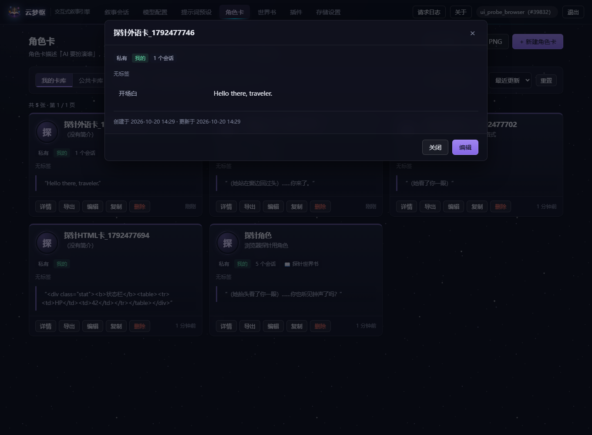

# 角色卡与世界书

> 云梦枢文档之一 · 返回 [README 索引](../README.md)

## 角色卡接口

角色卡是叙事引擎的「人设」载体：告诉模型它要扮演谁。除增删改查外，
还支持**公共卡库**与**业界标准格式的导入导出**。

| 方法 | 路径 | 说明 |
|---|---|---|
| `GET` | `/character-cards` | 列出角色卡（支持范围 / 搜索 / 标签筛选 / 排序 / 分页） |
| `POST` | `/character-cards` | 新建角色卡 |
| `GET` | `/character-cards/{id}` | 查看详情（全文） |
| `PATCH` | `/character-cards/{id}` | 修改（只传要改的字段，传 `null` 表示清空；可关联世界书） |
| `DELETE` | `/character-cards/{id}` | 删除（**可选择是否一并删除对话记录 / 世界书**，见下） |
| `POST` | `/character-cards/{id}/duplicate` | 复制一份到自己名下（世界书会一并复制） |
| `GET` | `/character-cards/{id}/export` | 导出为 Character Card V2 JSON（含 `character_book`） |
| `POST` | `/character-cards/import` | 导入 Character Card V2 / V1 JSON |
| `POST` | `/character-cards/import-png` | 导入角色卡 **PNG 图片**（生态主流分发格式） |
| — | — | 世界书相关接口见下方「世界书接口」 |

### 可见性规则：能看不等于能改

`scope` 参数决定列表返回什么：

| `scope` | 含义 |
|---|---|
| `mine`（默认） | 只看自己的 |
| `public` | 公共卡库，只列**别人**公开的卡 |
| `all` | 我能看到的全部（自己的 + 别人公开的） |

对单张卡的操作权限：

| 卡的归属 | 查看 | 修改 / 删除 |
|---|---|---|
| 自己的（公开或私有） | ✅ 200 | ✅ 允许 |
| 别人的**公开**卡 | ✅ 200（`is_owner: false`） | ❌ **403**，并提示「可以先复制一份到自己名下」 |
| 别人的**私有**卡 | ❌ 404 | ❌ 404 |

> ★ 这里 403 与 404 的取舍是刻意的，而且与模型配置接口**相反**：
> 模型配置一律 404，因为 403 会泄露「这个 ID 存在」；
> 而公开卡本来就是给人看的，调用方刚刚还能读到它，
> 此时回 404 反而让人以为卡被删了。403 也不泄露任何新信息。
> 私有卡则一律 404，不暴露其存在。

### ★ 删除角色卡：两个由你决定的选项

删一张卡会牵连两样东西，**都交给用户勾选**，而不是一刀切：

| 参数 | 默认 | 说明 |
|---|---|---|
| `delete_sessions` | `true` | 是否连同用它开的**对话记录**一起删除 |
| `delete_world_book` | `true` | 是否连同它关联的**世界书**一起删除 |
| `force` | `false` | 确认执行。不带它且卡上挂着东西时，返回 409 |

两个参数默认都是 `true`，对应界面上**默认勾选**的复选框；取消勾选即可保留。

#### 推荐前端走两步

**第一步**：直接发 `DELETE`。如果卡上挂着东西，会返回 `409`，
detail 里写清楚了挂着什么 —— 这就是渲染勾选弹窗所需的数据：

```json
{ "code": "CONFLICT",
  "message": "删除这张角色卡会牵连到其它数据，请确认要一并处理哪些",
  "detail": {
    "card_id": 12,
    "session_count": 3,
    "has_world_book": true,
    "world_book_id": 7,
    "world_book_name": "克苏鲁世界",
    "world_book_shared_by_other_cards": 2,
    "options": { "delete_sessions": "是否连同对话记录一起删除（默认 true）",
                 "delete_world_book": "是否连同世界书一起删除（默认 true）" }
  } }
```

**第二步**：用户确认后，带上 `?force=true` 与勾选结果重发。

```powershell
# 删卡 + 删对话，但保留世界书
curl -X DELETE "http://127.0.0.1:8000/api/v1/character-cards/12?force=true&delete_world_book=false" `
  -H "Authorization: Bearer <token>"
```

> ★ 为什么要多一道 `force`：默认值是「全删」，破坏性很强。
> 加一道显式确认，「手滑敲了个 DELETE」就不会造成不可逆的损失。

#### 世界书有可能「勾了删但没删掉」

如果这本世界书还被**别的**角色卡共用，为了不影响它们，世界书会被保留。
接口会如实回报，前端请展示给用户 —— 不能让用户以为已经删干净了：

```json
{ "code": "OK",
  "message": "角色卡已删除，连同 3 个会话（还有 2 张角色卡在使用它，为避免影响它们，世界书已保留）",
  "data": { "deleted_sessions": 3, "deleted_world_book": false,
            "world_book_kept": true,
            "world_book_kept_reason": "还有 2 张角色卡在使用它，为避免影响它们，世界书已保留" } }
```

### PATCH 怎么「清空」一个字段

字段**不出现**在请求体里 → 保持原值；字段出现且为 `null` → 清空。

```json
{ "greeting": null }     // 清空开场白
{ "tags": null }         // 标签清空成 []
{ "personality": "x" }   // 只改性格，其余字段一律不动
```

实现上依赖 Pydantic v2 的 `model_fields_set` —— 它记录本次请求**实际提交了哪些字段名**。
不这样做的话，`None` 既代表「没传」又代表「要清空」，无法区分。
（模型配置接口的 API Key 也遇到同一个问题，那边的解法是额外加一个 `clear_api_key` 开关；
角色卡字段太多，用 `model_fields_set` 更干净。）

### 列表返回的不是完整对象

`GET /character-cards` 返回**精简结构**（`CharacterCardBrief`），
不含开场白、对话示例、系统提示词等长文本字段，只给 `has_greeting` 与 `greeting_preview`。

原因：角色卡里有 4 个 `MEDIUMTEXT` 字段，单张卡就可能上百 KB。
列表若把 20 张卡全文都返回，响应体轻易上兆，页面会明显卡顿。
需要全文时调详情接口。

分页结构如下（`has_more` 由后端算好，前端不必自己推）：

```json
{ "items": [ ], "total": 42, "limit": 20, "offset": 0, "has_more": true }
```

> 分页只用在角色卡上，没有硬套到 `/providers`：
> 模型配置是一个人的私人设置，通常不超过十条，分页纯属多余。
> **数据量级不同，接口设计就不该套同一个模子。**

### 与 Character Card V2 规范互操作

角色卡不是本项目发明的概念。SillyTavern 生态有一套事实标准
[Character Card V2](https://github.com/malfoyslastname/character-card-spec-v2)
（`spec: chara_card_v2` / `spec_version: 2.0`），本项目支持双向转换：

| 本表字段 | Character Card V2 |
|---|---|
| `name` / `description` / `personality` / `scenario` | 同名 |
| `greeting` | `data.first_mes` |
| `example_dialogue` | `data.mes_example` |
| `alternate_greetings` | `data.alternate_greetings` |
| `system_prompt` | `data.system_prompt` |
| `post_history_instructions` | `data.post_history_instructions` |
| `tags` | `data.tags` |
| `background` / `speaking_style` / `avatar_url` | 规范没有 → 放进 `extensions.hne` 命名空间 |
| **世界书**（独立表 `world_books`） | `data.character_book` |
| `extra_data` | 其余字段（`creator`、`character_version` 等）原样保留 |

```powershell
# 导入一张从网上下载的角色卡
curl -X POST http://127.0.0.1:8000/api/v1/character-cards/import `
  -H "Authorization: Bearer <token>" -H "Content-Type: application/json" `
  -d '{"card": {"spec":"chara_card_v2","spec_version":"2.0","data":{"name":"爱丽丝","first_mes":"你好，旅人。"}}}'

# 导出（返回的 data 可直接存成 .json）
curl http://127.0.0.1:8000/api/v1/character-cards/12/export `
  -H "Authorization: Bearer <token>"
```

**两个刻意的实现细节：**

1. **导入导出往返无损。** 规范硬性要求「不得丢弃无法识别的字段」。
   本项目没有对应列的字段（如 `character_book` 角色专属世界书、
   别的插件写在 `extensions` 里的内容）会整包存进 `extra_data`，导出时原样还回去。
   有一个测试专门做「导出 → 导入 → 再导出」，断言两次结果**完全相等**。

2. **缺省文本字段导出为空字符串 `""` 而不是 `null`。**
   规范把这些字段定义为 `string`，给 `null` 有些严格的导入器会直接报错。

### ★ 直接导入网上下载的角色卡 PNG

SillyTavern 生态里角色卡**主要以 PNG 形式传播**，而不是 `.json` 文件 ——
卡片数据被塞进图片的文本块里，图片本身还能正常显示成人物立绘，
一张图就是完整的卡，分享出去不会丢东西。

> ★ 注意：**导入只取卡数据**（名字 / 开场白 / 世界书）。PNG 的图片字节在抽出卡片 JSON
> 之后就被丢弃了，**不会入库**，也不会自动成为 VN 立绘 / 背景 / 头像 ——
> 那些要在卡编辑器的 🎭 VN 立绘（或头像地址）里自己填图片地址。
> 想做"PNG 图片自动当立绘"要先定存储方案：上传上限 10MB 而 VN 单条地址上限
> 300,000 字符，base64 还要膨胀 4/3，直接内嵌必爆（要么导入时压缩，要么加静态文件挂载）。

```powershell
curl -X POST http://127.0.0.1:8000/api/v1/character-cards/import-png `
  -H "Authorization: Bearer <token>" `
  -F "file=@爱丽丝.png" -F "is_public=false"
```

**它是怎么工作的**（`app/utils/png_card.py`，零依赖，约 200 行）：

```
PNG 文件 = 文件头 + 一串数据块
           每个块 = [长度4B][类型4B][数据NB][CRC4B]

tEXt 块的数据 = "关键字 \0 文本"
                 chara \0 eyJzcGVjIjoiY2hhcmFfY2FyZF92MiIs...   ← base64 的 JSON
                 ccv3  \0 ...                                   ← 较新的 V3 格式
```

解析器会：校验 PNG 文件头 → 遍历数据块 → 取 `ccv3`（优先）或 `chara` 块
→ 先按 base64 解、失败则按裸 JSON 解 → 交给**和 JSON 导入完全相同**的流程。

几个刻意的实现选择：

| 选择 | 原因 |
|---|---|
| 同时支持 `tEXt` 与 `iTXt` | `iTXt` 支持 zlib 压缩与 UTF-8，少数工具用它 |
| `ccv3` 优先于 `chara` | 新工具会同时写入两个块（向后兼容）；取错会拿到过时数据 |
| base64 与裸 JSON 都试 | 标准是 base64，但确实有工具直接塞 JSON 原文 |
| **不校验 CRC** | CRC 是查损坏用的；图片轻微损坏但卡片块完好时，为此拒绝一张卡毫无帮助 |
| 单文件上限 10 MB | 解析要整个读进内存，**不设上限传个大文件就能把服务撑爆** |
| 报错时提示改走哪个接口 | 用户上传错文件（比如 `.json`）时，告诉他该用哪个接口，而不是只说「格式错误」 |

> **为什么卡片数据要 base64？** `tEXt` 是 PNG 早期定的块类型，按规范只能存
> **Latin-1** 字符，直接放中文会写不进去；而卡片 JSON 是 UTF-8 的。
> base64 的结果全是 ASCII，套一层就能安全塞进 `tEXt` —— 这就是那个编码的由来。
> （后来的 `iTXt` 原生支持 UTF-8，所以走 `iTXt` 的卡往往不做 base64。）

测试用的 PNG 是**在测试里真实构造**的（正确的文件头、IHDR、IDAT、逐块 CRC32），
而不是随便拼几个字节 —— 并且额外验证过这些夹具的 CRC 全部正确、IDAT 能正常解压，
确保测出来的结论对真实文件同样成立。

### ★ HTML 美化：正文与卡片**分段混排**，不再"一条消息整段渲染或不渲染"

角色卡（尤其从卡库分享来的）常常是**对话正文写纯文本、状态/属性面板写 HTML**。
旧实现是"一条消息**要么**整段进 iframe 渲染、**要么**整条当源码"—— 只要正文里出现一个 `<`，
整条消息（包括大段小说正文）就会被塞进 iframe，字体、行距、分段全变得跟正文不一样。

现在的规则：按**围栏**把消息切成若干段，每段各自决定怎么显示，**顺序严格保持原文顺序**。

| 位置 | 行为 |
|---|---|
| **分段规则** | 按围栏切片：**卡片围栏** → 渲染成卡片；其余围栏（```json```、```python```、无语言标记的普通代码块）与**围栏外的正文** → **纯文本原样显示**。模型写出来的东西与用户看到的顺序一一对应 |
| ★ 卡片围栏怎么认 | 对齐酒馆助手的约定，认"围栏体**确实是 HTML**"：` ```html ` 直接算；**无语言标记的围栏**要体里出现 `<body` / `<!doctype` / `<div` / `<style` 这类真标签才升级成卡片。```python```、```HP 42``` 这种**一律不当卡片** —— 误判会把正文吃掉、还会断掉排版。这条规则由浏览器探针 `10.12 混排消息` / `10.13 围栏卡片` 真机覆盖（造卡 → 发消息 → 读真实 DOM 的段落顺序与 iframe 数量） |
| 渲染容器 | `iframe sandbox="allow-same-origin"` —— **故意不给 `allow-scripts`**，卡片里的脚本一行都跑不起来 |
| 为什么用 iframe | 卡片自带 `<style>`，直接插进主文档的话一条 `body{display:none}` 就能把控制台变白；反过来卡片写成 `body{font-size:32px}` 也会污染正文。**样式隔离是刚需** |
| CSS 清洗 | 挡掉 `@import` / `expression()` / `javascript:` / `behavior:`；**保留 `url()`**（背景图是美化常用手段，取舍见 `ui.js` 注释） |
| 图片 | 只放行 `http(s)://`、`data:image/*;base64`、站内绝对路径（挡掉 `//evil.com`） |
| 宏 | 渲染前把 `{{char}}` / `{{user}}` 换成真名 |
| 切换 | **每个卡片段**都给「渲染视图 / 源码」两个页签 —— 渲染异常时用户能自己看到那一段的原文 |
| 生效范围 | 角色卡详情（开场白 + 备选开场白）+ **对话窗口**（流式结束后切换） |
| ★ 配色跟随主题 | iframe 是一份**独立文档**，父页面的 CSS 变量不会继承进去。所以文档头不是写死的，而是渲染时 `richDocHead()` 从父页面读当前主题变量（`--surface-2/--text/--border`…）注入 —— 否则深色主题下这里永远是**一整块白**（用户反复反馈的那块白就是它） |

**备选开场白是"一条一页"的**：一条开场白本身就可能上千字、几十行，
所以用「上一条 / 下一条」翻页，**绝不按换行拆分**
（旧实现 `join('\n')/split('\n')` 把 1 条 67 行的开场白变成 67 条 → 保存 422，
见 `docs/pitfalls.md` 第 32 条）。



### ★ 界面主题（CSS 主题插件）与"那块白"的来龙去脉

系统名 **云梦枢（YunMeng Hub）**：云 = 云端 AI，梦 = 沉浸式叙事，枢 = 系统中枢（谐音"书"，
寓意世界书与故事线）。顶栏与登录页的图标就是这条命名的图形化：紫云托着一本翻开的书、
上方是罗盘星与环绕的星体（设计稿原稿在 `assets/icon/logo-source.png`，
白底用 `scripts/make_icon_assets.ps1` 的**四角洪水填充**去掉 —— 不能用"全图白色→透明"，
否则书页会被打出窟窿）。

内置目录里有一条**「云梦枢 · 星云暗涌」**主题：深空底 + 两团极弱星云（左上紫 / 右下青）
+ **一片三档层次的星点**（约 40 颗/层组：小暗点铺底、中等点、亮点带光晕；
渲染峰值约 160，只有正文文字亮度（230）的三分之二：能看出是星空，但不会把眼睛从正文里拽走）
+ 毛玻璃面板 + 细线微光，一键添加/停用，**完全可逆**（不动任何数据）。
配色有明确分工：**量子紫 `#A78BFA` = 状态**（选中、"我"的声音）、
**极光青 `#00E5FF` = 交互**（悬停、聚焦、AI 侧微光）。

> ★ **内置条目会升级，而你添加的那份是"拷贝"**：插件内容在你点「添加」时存进数据库，
> 所以内置主题后来改进了，你那份不会自动变。目录里会给这类条目打上 **`有更新`** 徽章，
> 点「**更新到最新**」即可覆盖成当前版本（同一个插件、不会多出一条）。

它是这么做到"只写变量就能换肤"的：

主题就是一条 `kind = "css"` 的声明式插件。它只往页面里注入一段 CSS，**不执行任何脚本**。
为了让换肤真的换得动，做了四件事：

| 做法 | 为什么 |
|---|---|
| 组件颜色一律走**语义变量**（`--surface` / `--surface-2` / `--surface-3` / `--panel` / `--text`…），不写死 `#fff`/`#fafbfc` | 写死的地方主题**换不掉**，深色下就是一块白（用户反馈"你注意那行白色的"） |
| 启停/增删 CSS 插件后**当场重取** `/plugins/theme.css` 并替换 `<style>` 内容 | 否则用户以为"插件没生效"，只能手动刷新 |
| iframe（HTML 开场白）**渲染时注入**当前主题变量 | iframe 是独立文档，父页面变量**不继承**（见上一节） |
| 引擎给"老主题"**只补缺**地补 `--surface-2/3`、`--panel` | 插件内容是用户点「添加」时拷进数据库的，目录升级不会改用户那份；没有这条，用户得删了重加 |
| **渐变**（`linear-gradient`）里的颜色也必须走变量 | 渐变画在 `background-image` 上，`backgroundColor` 读出来是**透明** —— 角色卡的开场白预览框以前写死了 `#f7f9fc→#f2f5fa`，深色下一整块白，而且**能躲过"背景色亮度"这类检查** |
| **JS 内联样式**同样要走变量（`zone.style.background = '#fafbfc'` 这类） | 拖拽上传区"回到静止态"时写死浅色，拖过一次文件后深色主题下就卡在浅色。测试里有一条静态守门人专扫 JS 里的 `background*` 字面量 |
| **提示框的边框色**走 `--warn-border` / `--danger-border` / `--info-border` / `--ok-border` | 边框以前写死成四个浅色：背景跟着主题变、**边框不变** → 深色下每个提示框镶一圈**亮边**。浅色默认值一字未改；老主题由引擎按"文字色 × 柔和底"的中间调补上 |
| 头像等小部件的**字色**走 `--catalog-accent`（没写就跟随 `--brand`） | "一半走变量"最典型的坑：底色是 `var(--brand-soft)`、字色写死 `#6b46c1` → 深色下深紫压深藏青**看不清**。有一条通用守门人专抓这种"底色变量化、文字没变量化"的配色 |
| 会话在**背后**被删掉（删卡时勾"连同对话记录"、别的标签页删的）时，前端**不再白打一次注定 404 的请求** | 列表本来就已经取回来了，先查再请求；否则浏览器控制台会留一条红色 404，用户以为前端坏了。探针有一条总检守住"除预期的 401/404 探路请求外，整轮无其他控制台报错" |

> 探针里有一条专门守这件事的断言：深色主题下**不许出现浅色块** ——
> 透明的元素会被单独列出来报告（防止"漏测还显示通过"），
> 品牌色（`--brand` 等）按颜色值放行（它们本来就该亮）。

### 角色卡允许重名

与模型配置的「别名唯一」不同，角色卡**不做唯一约束**。
同名的两张卡内容很可能不同（「小明·校园篇」与「小明·侦探篇」都叫「小明」），
强行要求唯一会逼用户改掉本来合适的名字。导入同名卡也能直接成功。

## 世界书接口

**世界书**（world book / lorebook）描述「这个故事发生在什么样的世界里」：
一组「关键词 → 设定文本」的条目。对话里提到某个关键词时，
就把对应条目的内容注入提示词 —— 这样模型能"记住"没写在人设里、但属于世界观的事实。

| 方法 | 路径 | 说明 |
|---|---|---|
| `GET` | `/world-books` | 列出我的世界书（搜索 + 分页） |
| `POST` | `/world-books` | 新建世界书 |
| `GET` | `/world-books/{id}` | 查看详情（含全部条目） |
| `PATCH` | `/world-books/{id}` | 修改（`entries` 为整体替换） |
| `DELETE` | `/world-books/{id}` | 删除（被角色卡使用时需加 `?force=true`） |

### ★ 它为什么是一个独立的表？

最初的实现把世界书当作角色卡里的一个字段（塞在卡的 `extra_data` 里），
后来发现两个绕不过去的问题：

1. **删卡就必然删世界书。** 用户想「删掉这张卡，但保留我写了几十个条目的世界书」
   是完全合理的诉求 —— 但字段和卡在同一个数据库行里，做不到。
2. **没法复用。** 同一套世界观往往要给多张卡用
   （「克苏鲁世界」下面可以有十几张不同角色的卡），
   塞在卡里就只能每张卡各存一份，改一处要改十几处。

所以它独立成表，角色卡通过 `world_book_id` 外键引用，
**一本世界书可被多张角色卡共用**。

### 条目（entries）的结构

```json
{
  "keys": ["龙", "巨龙"],          // 触发关键词
  "content": "世上最后一条龙已在三百年前死去",   // 命中后注入提示词的文本
  "enabled": true,                 // 是否启用
  "insertion_order": 0,            // 多条同时命中时的插入顺序
  "extensions": {}                 // 规范要求存在
}
```

校验策略是**规范化 + 明确报错**，而不是悄悄丢弃：

| 情况 | 处理 |
|---|---|
| 缺 `keys` | 补成空数组 |
| `keys` 写成字符串 | 宽容地当成只含一个关键词 |
| 关键词有空白 / 重复 | 去空白 + 去重（保留原顺序） |
| 缺 `enabled` / `insertion_order` | 补默认值 `true` / `0` |
| **缺 `content`** | **报错（422）** —— 静默丢掉会让用户以为导入成功了，实际少一条设定 |
| 我们不认识的字段（`position`、`priority`…） | **原样保留**，保证导回 SillyTavern 时不丢设置 |

### 删除保护

默认拒绝删除「还有角色卡在用」的世界书，并在 detail 里列出**具体是哪几张卡**：

```json
{ "code": "CONFLICT",
  "detail": { "card_count": 2,
              "cards": [{"id": 3, "name": "爱丽丝"}, {"id": 5, "name": "鲍勃"}],
              "hint": "确认要删除时，请在请求里加上 ?force=true" } }
```

加 `?force=true` 才真删；相关卡片的关联会被置空，但**卡片本身不受影响**。

### 与角色卡建立关联

```powershell
# 关联（也可以在建卡时直接传 world_book_id）
curl -X PATCH http://127.0.0.1:8000/api/v1/character-cards/12 `
  -H "Authorization: Bearer <token>" -H "Content-Type: application/json" `
  -d '{"world_book_id": 7}'

# 解除关联
curl -X PATCH http://127.0.0.1:8000/api/v1/character-cards/12 `
  -H "Authorization: Bearer <token>" -H "Content-Type: application/json" `
  -d '{"world_book_id": null}'
```

> ★ 关联时会校验这本书确实属于当前用户，否则返回 404。
> 不校验的话，用户就能把别人的世界书挂到自己的卡上，再连卡带书一起导出 ——
> 等于把别人的设定集偷走（典型的 IDOR 漏洞）。

> ★ **复制角色卡时，世界书会被复制成新的一本**，而不是两张卡共享同一个。
> 否则用户改副本的世界书会把原卡的也改掉，非常反直觉。

### 世界书没有「公开」选项

角色卡有 `is_public`（要建公共卡库），世界书没有。因为世界书总是跟着卡走的 ——
别人要用你的世界观，直接**复制那张卡**即可（复制会把世界书一并复制到对方名下）。
再单独做一套「公开世界书库」属于另一个功能，当前不需要。

> ★ 关键词触发检索（3.9 已完成）：只把**最近若干条消息里提到的**设定注入提示词，
> 详见 [记忆与检索](记忆与检索.md) 的「世界书：从"全量注入"改成"按关键词触发"」。
> `recursive_scanning`（递归扫描）仍未实现，
> 字段照样原样保存与导出。

---

← 返回 [README](../README.md)
